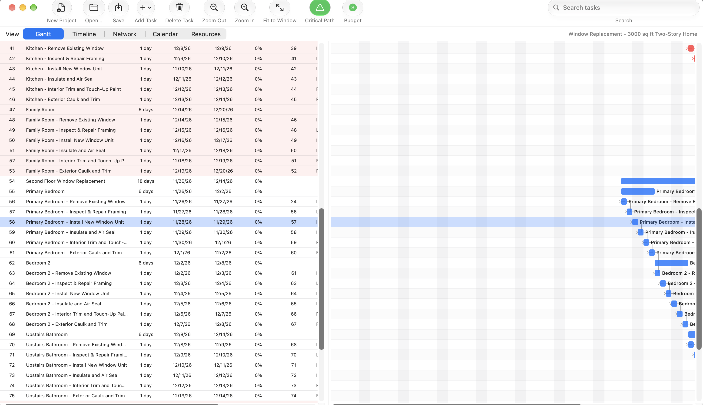
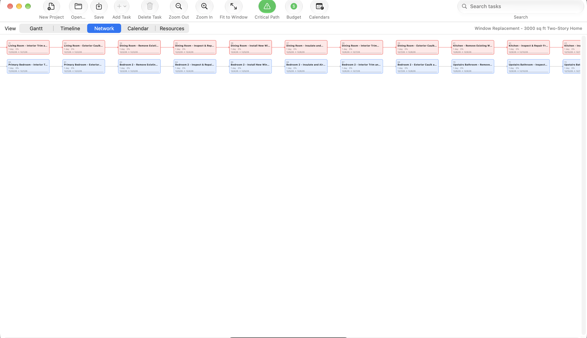
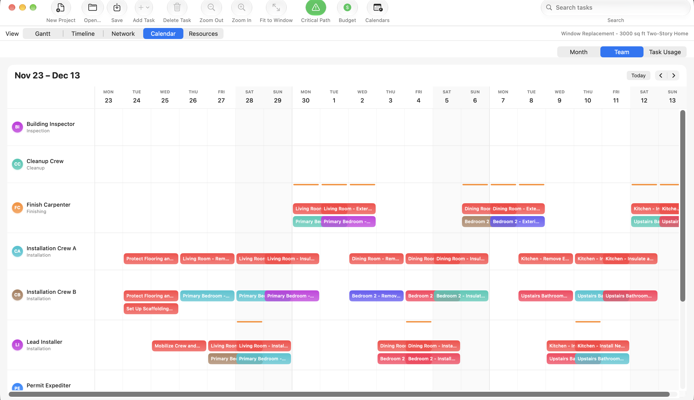
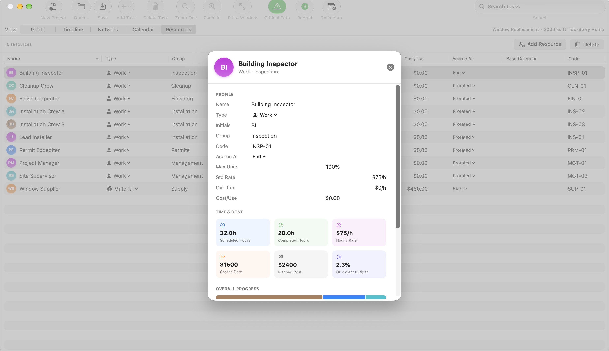

# MPP Viewer (macOS)

A native Swift/AppKit macOS app for viewing and editing Microsoft Project and related project-management
file formats — Gantt chart, Timeline, Network (PERT) diagram, Calendar (with three modes), Resources, a
working-time calendar editor, project-budget tracking, and export.

This is a macOS port of an existing Windows WPF/.NET application (`MPP-Viewer`).

## What it does

- **Opens** Microsoft Project (`.mpp`, `.mpt`), Project XML/MSPDI (`.xml`), Microsoft Project Exchange
  (`.mpx`), GanttProject (`.gan`), Primavera P6 (`.xer`, `.pmxml`), Asta Powerproject (`.pp`, `.ppx`),
  SureTrak (`.stx`), Phoenix Project Manager (`.pod`), and several other formats supported by the
  underlying MPXJ library.
- **Five views**, reachable from the view switcher:
  - **Gantt** — WBS task table + chart, with inline editing of name, duration, dates, % complete,
    predecessors (type and lag), notes, and resource assignments.
  - **Timeline** — a condensed, always-fit top-level overview, the same idea as Microsoft Project's own
    Timeline view.
  - **Network** — a PERT-style dependency diagram, laid out in layers by dependency depth. Pans by
    drag or two-finger scroll; Command+scroll or pinch zooms, anchored under the cursor.
  - **Calendar** — three modes, switched with a toggle: **Month** (a traditional grid), **Team** (a
    per-resource weekly timeline with over-allocation warnings), and **Task Usage** (a per-task
    timephased-work spreadsheet, hours per day per assignment).
  - **Resources** — a resource sheet (rates, availability, custom types) with a double-click detail
    inspector per resource (scheduled/completed hours, cost to date, engagement list).
- **Calendars** (toolbar button) — a separate editor for working-time calendar *definitions*: which
  days of the week are normally working days, plus holiday/makeup-day exceptions. Multiple calendars
  per project are supported. This edits real, round-trippable data, but the scheduler below doesn't
  consume it yet — see "What it does not do."
- **Project-wide budget tracking** — planned vs. progress-weighted "earned" cost, status, per-resource
  breakdown — using the same Budget Resource / Project Summary Task convention Microsoft Project itself
  uses, so a budget set here round-trips correctly if the file is later opened there.
- **Export and print** — CSV of the full task list; PDF, PNG, or direct printing of a Timeline snapshot.
- **Find**, Find Next/Previous, and Find and Replace across task names and notes.
- A full in-app **Help system** (Help menu, or ⌘?) — searchable documentation for every feature, option,
  and keyboard shortcut.
- **Undo/redo** for essentially every edit.

## What it does not do

- **Write back to the original file format.** Save and Save As always produce Project XML (MSPDI),
  regardless of what format the file was opened from — the underlying library can read far more formats
  than it can reliably write. See TROUBLESHOOTING.md.
- **Use working-time calendars in scheduling.** Scheduling (what happens to later tasks when you edit a
  task's dates or duration, and the critical path itself) is a hand-rolled calendar-day forward/backward
  pass — a fixed 8-hour day, 5-day week — not Microsoft Project's own engine. The Calendars editor lets
  you define holidays and a working week, and that data is saved for real, but the scheduler doesn't read
  it back yet — editing a calendar won't shift any dates or change what's critical.
- **Match Microsoft Project's critical path to the day, when calendars are involved.** "Highlight
  Critical Path" is a real, live backward-pass calculation (late dates, float, critical = zero float) —
  edit a duration or a dependency and it recomputes automatically, including for a project built entirely
  from scratch here. What it doesn't do is account for holidays/non-working days (see above), so a file
  that depends on Microsoft Project's own calendar system can diverge by however many non-working days
  fall inside the affected span.
- **Rearrange the toolbar.** Toolbar customization (drag-to-reorder, remove buttons, restore defaults)
  is intentionally unavailable — it reliably crashed the app on the macOS version this was built against,
  and was removed rather than shipped broken. See TROUBLESHOOTING.md for the full history.

## Architecture

The app is two processes:

- **`App/`** — the native Swift/AppKit UI, built as a Swift package (not an Xcode project). SwiftUI
  views, an `AppModel` that owns the current project's state and undo stack, and a hand-rolled
  forward-pass scheduler.
- **`Helper/`** — a .NET console application that does all file reading and writing, using the
  [MPXJ.Net](https://www.mpxj.org/) library. The Swift app launches it as a subprocess and talks to it
  over a private, local, line-delimited JSON protocol on stdin/stdout. Nothing is sent over the network;
  no project file data leaves the machine as part of normal use. The distributed `.pkg` bundles a
  self-contained publish of the Helper, so installing it does not require a separate .NET install.

See `BUILDING.md` for how to build and run both halves from source, and the in-app Help (Help menu) for
complete, searchable documentation of every feature from a user's point of view.

## Screenshots

| Gantt | Network |
|---|---|
|  |  |

| Calendar (Team mode) | Resource detail |
|---|---|
|  |  |

## Installing

Download the latest `.pkg` from [Releases](../../releases) and run it. Requires Apple Silicon (arm64)
and macOS 26 or later.

The installer and the app inside it are both code-signed with a Developer ID, but **not notarized** —
macOS Gatekeeper will still flag a downloaded, unnotarized app on first launch. Open System Settings ▸
Privacy & Security after the first blocked attempt and choose "Open Anyway" next to the app's name; see
TROUBLESHOOTING.md if that option doesn't appear.

Prefer not to run an unnotarized download, or need an Intel build? Build it from source instead — see
`BUILDING.md`. You'll need Xcode (for the Swift app) and the .NET SDK (for the file-reading Helper).

## Status

Actively developed, not yet feature-frozen. A signed, unnotarized `.pkg` installer is available under
Releases; building from source remains fully supported — see `BUILDING.md`.
