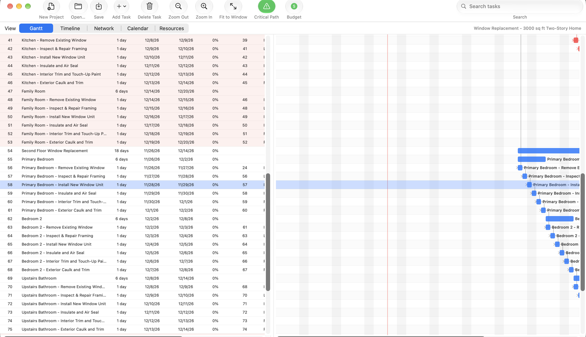
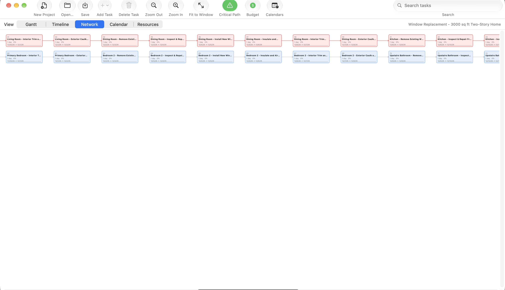
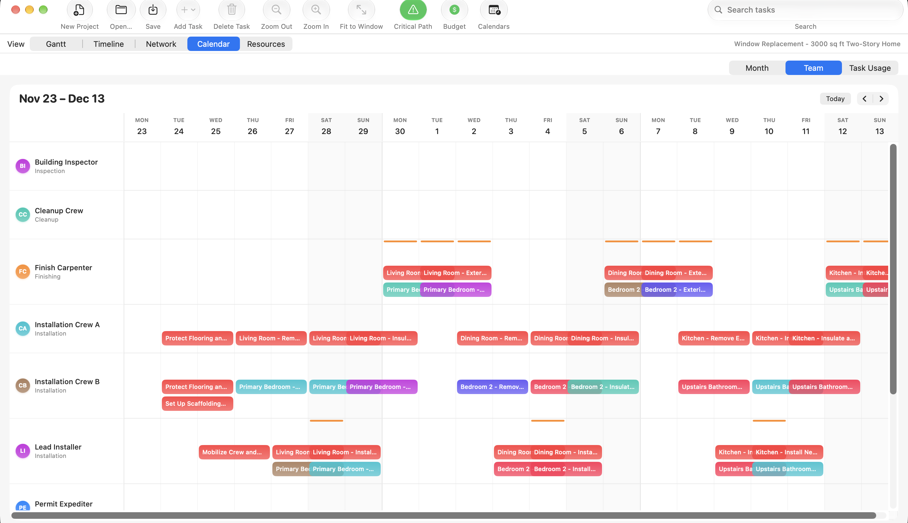
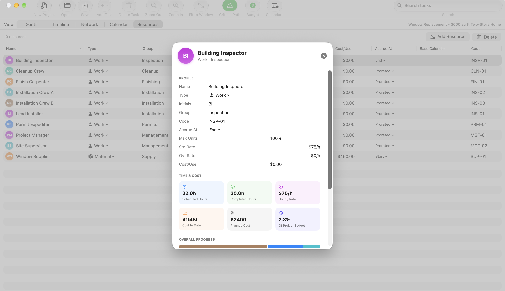

# MPP Viewer (macOS)

**Open and edit Microsoft Project files on a Mac, without Microsoft Project.** MPP Viewer reads `.mpp`,
Project XML, Primavera P6, GanttProject, Asta Powerproject and more, and shows them as a Gantt chart,
timeline, network diagram, calendar and resource sheet, with a critical path that recalculates as you edit.
Native Swift and AppKit, free, MIT licensed, no account and no telemetry.

| Network (PERT) | Timeline | Calendar (Team) |
|---|---|---|
|  |  |  |

**[Download](../../releases)** · [Website](https://ramos1053.github.io/MPP-Viewer-Mac/) ·
[Installing](#installing) · [Building from source](BUILDING.md)

This is a macOS port of an existing Windows WPF/.NET application (`MPP-Viewer`).

## What it does

- **Opens** Microsoft Project (`.mpp`, `.mpt`), Project XML/MSPDI (`.xml`), Microsoft Project Exchange
  (`.mpx`), GanttProject (`.gan`), Primavera P6 (`.xer`, `.pmxml`), Asta Powerproject (`.pp`, `.ppx`),
  SureTrak (`.stx`), Phoenix Project Manager (`.pod`), and several other formats supported by the
  underlying MPXJ library.
- **Five views**, reachable from the view switcher:
  - **Gantt**: WBS task table and chart, with inline editing of name, duration, dates, % complete,
    predecessors (type and lag), notes, and resource assignments.
  - **Timeline**: a condensed, always-fit top-level overview, the same idea as Microsoft Project's own
    Timeline view.
  - **Network**: a PERT-style dependency diagram, laid out in layers by dependency depth. Pans by
    drag or two-finger scroll; Command+scroll or pinch zooms, anchored under the cursor.
  - **Calendar**: three modes, switched with a toggle. **Month** is a traditional grid, **Team** is a
    per-resource weekly timeline with over-allocation warnings, and **Task Usage** is a per-task
    timephased-work spreadsheet, hours per day per assignment.
  - **Resources**: a resource sheet (rates, availability, custom types) with a double-click detail
    inspector per resource (scheduled/completed hours, cost to date, engagement list).
- **Calendars** (toolbar button): a separate editor for working-time calendar *definitions*, meaning which
  days of the week are normally working days, plus holiday/makeup-day exceptions. Multiple calendars
  per project are supported. This edits real, round-trippable data, but the scheduler below doesn't
  consume it yet. See "What it does not do."
- **Project-wide budget tracking**: planned vs. progress-weighted "earned" cost, status, and a per-resource
  breakdown. It uses the same Budget Resource / Project Summary Task convention Microsoft Project itself
  uses, so a budget set here round-trips correctly if the file is later opened there.
- **Export and print**: CSV of the full task list; a PDF of the entire project (the real Gantt chart,
  every task, sized to fit); PNG or direct printing of a condensed Timeline snapshot.
- **Find**, Find Next/Previous, and Find and Replace across task names and notes.
- An in-app **Help system** (Help menu, or ⌘?) with searchable documentation for every feature, option,
  and keyboard shortcut.
- **Undo/redo** for essentially every edit.

## What it does not do

- **Write back to the original file format.** Save and Save As always produce Project XML (MSPDI),
  regardless of what format the file was opened from. The underlying library can read far more formats
  than it can reliably write. See TROUBLESHOOTING.md.
- **Use working-time calendars in scheduling.** Scheduling (what happens to later tasks when you edit a
  task's dates or duration, and the critical path itself) is a hand-rolled calendar-day forward/backward
  pass with a fixed 8-hour day and 5-day week. It is not Microsoft Project's own engine. The Calendars
  editor lets you define holidays and a working week, and that data is saved for real, but the scheduler
  doesn't read it back yet. Editing a calendar won't shift any dates or change what's critical.
- **Match Microsoft Project's critical path to the day, when calendars are involved.** "Highlight
  Critical Path" is a real, live backward-pass calculation (late dates, float, critical = zero float).
  Edit a duration or a dependency and it recomputes automatically, including for a project built entirely
  from scratch here. What it doesn't do is account for holidays/non-working days (see above), so a file
  that depends on Microsoft Project's own calendar system can diverge by however many non-working days
  fall inside the affected span.
- **Rearrange the toolbar.** Toolbar customization (drag-to-reorder, remove buttons, restore defaults)
  is intentionally unavailable. It reliably crashed the app on the macOS version this was built against,
  and was removed rather than shipped broken. See TROUBLESHOOTING.md for the full history.

## Architecture

The app is two processes:

- **`App/`**: the native Swift/AppKit UI, built as a Swift package (not an Xcode project). SwiftUI
  views, an `AppModel` that owns the current project's state and undo stack, and a hand-rolled
  forward-pass scheduler.
- **`Helper/`**: a .NET console application that does all file reading and writing, using the
  [MPXJ.Net](https://www.mpxj.org/) library. The Swift app launches it as a subprocess and talks to it
  over a private [line-delimited JSON protocol](docs/protocol.md) on stdin/stdout. Nothing is sent
  over the network; no project file data leaves the machine as part of normal use. The distributed
  `.pkg` bundles a self-contained publish of the Helper, so installing it does not require a separate
  .NET install.

See `BUILDING.md` for how to build and run both halves from source, and the in-app Help (Help menu) for
complete, searchable documentation of every feature from a user's point of view.

## More screenshots

| Gantt | Network |
|---|---|
|  |  |

| Timeline |
|---|
|  |

| Calendar (Month mode) | Calendar (Team mode) |
|---|---|
|  |  |

| Calendar (Task Usage mode) | Working-time calendar editor |
|---|---|
|  |  |

| Resource sheet | Resource detail |
|---|---|
|  |  |

## Installing

Download a `.pkg` from [Releases](../../releases) and run it. Installers are per architecture: the one
with `x64` in its name is for **Intel Macs**, the other (named `arm64`, or with no architecture in the
name on older releases) is for **Apple Silicon**. Apple menu ▸ About This Mac shows which chip you have.
Requires macOS 26 or later.

**Intel status:** the Intel installer is published as a pre-release. It has been built, signed and
checked under Rosetta 2 on an Apple Silicon Mac, but not yet run on a real Intel Mac. If you have one,
please try it and report back on [issue 3](../../issues/3).

The installer and the app inside it are both code-signed with a Developer ID, but **not notarized**.
macOS Gatekeeper will still flag a downloaded, unnotarized app on first launch. Open System Settings ▸
Privacy & Security after the first blocked attempt and choose "Open Anyway" next to the app's name; see
TROUBLESHOOTING.md if that option doesn't appear.

Prefer not to run an unnotarized download? Build it from source instead. See
`BUILDING.md`. You'll need Xcode (for the Swift app) and the .NET SDK (for the file-reading Helper).
There's no `.xcodeproj` to double-click. The app is a Swift package, so you either open
`App/Package.swift` directly in Xcode or build it from the command line with `swift build`; both are
covered in `BUILDING.md`.

## Status

Actively developed, not yet feature-frozen. A signed, unnotarized `.pkg` installer is available under
Releases, one per architecture (arm64 and x64); building from source remains fully supported. See `BUILDING.md`.
